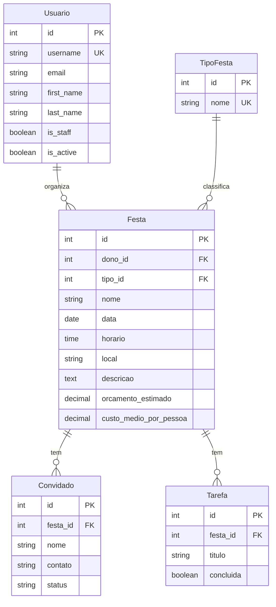

# Sua Festa

Aplicação web para organizar festas: o usuário cadastra suas festas, registra os convidados e acompanha as confirmações de presença, os custos e a lista de preparativos.

Trabalho prático da disciplina **GAC116 – Programação Web** (desenvolvimento de uma aplicação com o framework Django).

## Integrantes

| Nome | GitHub |
|---|---|
| Davi Pedro | [@davipedro](https://github.com/davipedro) |
| Vinícius Oliveira | [@viniciusdev7](https://github.com/viniciusdev7) |

## Descrição

O Sua Festa é um centralizador de informações de festas (aniversários, churrascos, confraternizações), convidados e custos. Cada festa tem tipo, data, horário, local, orçamento estimado e custo médio por pessoa. Dentro da festa é possível cadastrar os convidados, marcar se vão (Pendente, Vou, Talvez ou Não vou) e montar uma lista de tarefas para os preparativos.

O projeto está em desenvolvimento. A primeira entrega cobre o banco de dados e o ambiente administrativo.

## Tecnologias

- Python 3.12
- Django 5.2 (LTS)
- SQLite
- django-jazzmin (tema do ambiente administrativo)
- python-decouple (configurações por variáveis de ambiente)

## Instalação

Pré-requisito: Python 3.12 instalado.

1. Clone o repositório e entre na pasta:

   ```bash
   git clone https://github.com/davipedro/organizador-festa-GAC116.git
   cd organizador-festa-GAC116
   ```

2. Crie e ative o ambiente virtual:

   ```bash
   python -m venv .venv
   # Windows (PowerShell)
   .venv\Scripts\Activate.ps1
   # Linux e macOS
   source .venv/bin/activate
   ```

3. Instale as dependências:

   ```bash
   pip install -r requirements.txt
   ```

4. Crie o arquivo `.env` a partir do exemplo e troque a `SECRET_KEY` por uma chave própria:

   ```bash
   # Windows (PowerShell)
   Copy-Item .env.example .env
   # Linux e macOS
   cp .env.example .env
   ```

   Para gerar uma chave:

   ```bash
   python -c "from django.core.management.utils import get_random_secret_key as g; print(g())"
   ```

5. Crie o banco de dados e um superusuário:

   ```bash
   python manage.py migrate
   python manage.py createsuperuser
   ```

## Execução

```bash
python manage.py runserver
```

O ambiente administrativo fica em http://127.0.0.1:8000/admin/. Para rodar os testes:

```bash
python manage.py test
```

## Principais funcionalidades

Disponíveis agora, no ambiente administrativo:

- Login com usuário e senha, usando um modelo de usuário próprio.
- Cadastro de tipos de festa, festas, convidados e tarefas.
- Festa com dono, tipo, data, horário, local, descrição, orçamento estimado e custo médio por pessoa.
- Status do convidado: Pendente, Vou, Talvez ou Não vou.
- Na tela da festa, convidados e tarefas editáveis na mesma página.
- Na lista de festas: filtros por tipo, data e status dos convidados, busca por nome, local e dono, navegação por data e coluna com o número de confirmados.

Previstas para as próximas entregas:

- Cadastro, login e logout para os usuários finais.
- Painel "Minhas festas" com o resumo de cada festa e o custo estimado.
- Interface responsiva, com tema claro e escuro.

## Como trabalhamos (Git)

- `main`: versão estável. Só recebe o que já está pronto e testado.
- `develop`: onde as funcionalidades são integradas.
- `feature/<nome>`: uma branch para cada tarefa, criada a partir da `develop`.

Fluxo: criar a branch `feature/<nome>`, fazer commits pequenos, abrir um Pull Request para a `develop` e pedir revisão do outro integrante. Antes de abrir o PR, atualizar a branch com `git pull origin develop` e rodar `python manage.py test`.

Mensagens de commit em português, com um prefixo: `feat:` (funcionalidade), `fix:` (correção), `docs:` (documentação), `test:` (testes) e `chore:` (configuração e manutenção).

## Banco de dados

O banco tem 5 tabelas e 4 relacionamentos, todos de um para muitos. A versão completa do diagrama, com as regras de exclusão, está em [docs/diagrama-er.md](docs/diagrama-er.md), e a descrição de cada campo em [docs/dicionario-de-dados.md](docs/dicionario-de-dados.md).



## Estrutura do projeto

```
.
├── manage.py
├── requirements.txt
├── .env.example           # nomes das variáveis de ambiente
├── organizadorfesta/      # configurações do projeto (settings, urls)
├── contas/                # usuários (modelo Usuario)
├── festas/                # festas, tipos de festa, convidados e tarefas
├── static/                # logo e CSS do tema do admin
└── docs/                  # diagrama ER e dicionário de dados
```
