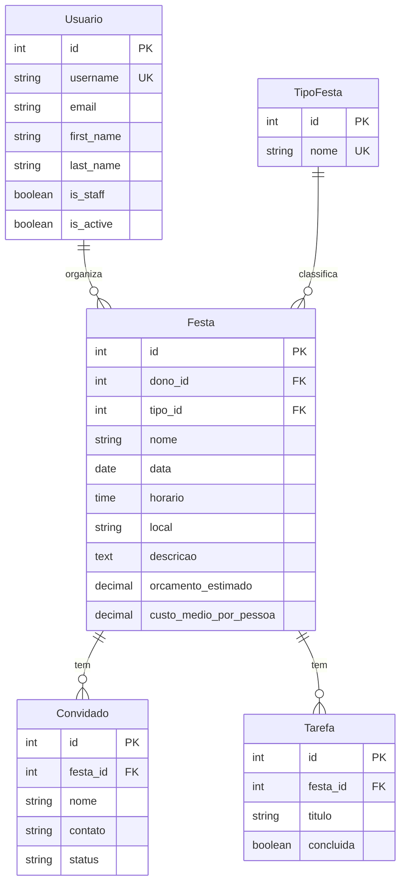

# Sua Festa

Aplicação web para organizar festas: o usuário cadastra suas festas, registra os convidados e acompanha as confirmações de presença, os custos e a lista de preparativos.

Trabalho prático da disciplina **GAC116 – Programação Web** (desenvolvimento de uma aplicação com o framework Django).

## Integrantes

| Nome | GitHub |
|---|---|
| Davi Pedro | [@davipedro](https://github.com/davipedro) |
| Vinícius Oliveira | [@viniciusdev7](https://github.com/viniciusdev7) |

## Descrição

O Sua Festa é um centralizador de informações de festas (aniversários, churrascos, confraternizações), convidados e custos. Cada festa tem tipo, data, horário, local, orçamento estimado e custo médio por pessoa. Dentro da festa é possível cadastrar os convidados, marcar se vão (Pendente, Vou, Talvez ou Não vou) e montar uma lista de tarefas para os preparativos.

O site tem duas áreas: a **área do usuário**, onde cada anfitrião se cadastra e gerencia as próprias festas, e o **ambiente administrativo** (Django Admin com tema Jazzmin), usado pela equipe para ver e filtrar todos os dados.

## Tecnologias

- Python 3.12
- Django 5.2 (LTS)
- SQLite
- django-jazzmin (tema do ambiente administrativo)
- python-decouple (configurações por variáveis de ambiente)
- Bootstrap 5.3.3 (framework CSS, servido localmente em `static/vendor/bootstrap`, sem CDN)
- HTML, CSS e JavaScript simples (tema claro/escuro e atualização das seções sem recarregar a página)

## Instalação

Pré-requisito: Python 3.12 instalado.

1. Clone o repositório e entre na pasta:

   ```bash
   git clone https://github.com/davipedro/organizador-festa-GAC116.git
   cd organizador-festa-GAC116
   ```

2. Crie e ative o ambiente virtual:

   ```bash
   python -m venv .venv
   # Windows (PowerShell)
   .venv\Scripts\Activate.ps1
   # Linux e macOS
   source .venv/bin/activate
   ```

3. Instale as dependências:

   ```bash
   pip install -r requirements.txt
   ```

4. Crie o arquivo `.env` a partir do exemplo e troque a `SECRET_KEY` por uma chave própria:

   ```bash
   # Windows (PowerShell)
   Copy-Item .env.example .env
   # Linux e macOS
   cp .env.example .env
   ```

   Para gerar uma chave:

   ```bash
   python -c "from django.core.management.utils import get_random_secret_key as g; print(g())"
   ```

5. Crie o banco de dados e um superusuário:

   ```bash
   python manage.py migrate
   python manage.py createsuperuser
   ```

## Execução

```bash
python manage.py runserver
```

Com o servidor no ar:

- Área do usuário: http://127.0.0.1:8000/
- Ambiente administrativo: http://127.0.0.1:8000/admin/ (precisa de um superusuário)

Para rodar os testes:

```bash
python manage.py test
```

## Dados de exemplo

Para carregar festas, convidados e tarefas de demonstração em um banco novo (depois do `migrate`):

```bash
python manage.py loaddata dados_exemplo
```

Usuários de demonstração, todos com a senha `demo12345`:

| Usuário | Perfil | Festas |
|---|---|---|
| `ana` | anfitriã | Aniversário de 30 anos da Ana e Confraternização da empresa |
| `bruno` | anfitrião | Churrasco de fim de ano e Chá de bebê da Carla |
| `admin` | administrador | acessa o `/admin/` |

Cada anfitrião só enxerga as próprias festas. Se tentar abrir a festa de outra pessoa, recebe a página 404.

## Principais funcionalidades

### Área do usuário

- **Cadastro, login e logout.** O cadastro cria apenas anfitriões comuns, nunca administradores. O logout é feito por POST.
- **Minhas festas.** Cards com data, local, número de confirmados e custo estimado de cada festa, com busca por texto e filtros por tipo e período (próximas, passadas ou todas).
- **Festas.** Criar, ver, editar e excluir. Antes de excluir, o sistema mostra quantos convidados e tarefas serão apagados junto.
- **Convidados.** Adicionar, editar, excluir e alterar o status (Pendente, Vou, Talvez ou Não vou) direto na tela da festa.
- **Tarefas.** Adicionar, editar, excluir e marcar como concluída, com progresso das tarefas na festa.
- **Custo.** Custo estimado = custo médio por pessoa × convidados com status "Vou". A tela avisa quando o custo passa do orçamento estimado.
- **Perfil.** Tela com os dados do usuário logado.
- **Interface.** Layout responsivo com Bootstrap, tema claro e escuro (a escolha fica salva no navegador) e mensagens de sucesso e erro.

### Ambiente administrativo

- Login com usuário e senha, usando um modelo de usuário próprio.
- Cadastro de tipos de festa, festas, convidados e tarefas.
- Na tela da festa, convidados e tarefas editáveis na mesma página.
- Na lista de festas: filtros por tipo, data e status dos convidados, busca por nome, local e dono, navegação por data e coluna com o número de confirmados.

## Principais rotas

| Rota | O que faz |
|---|---|
| `/` | Minhas festas (exige login) |
| `/contas/cadastro/` | Cadastro de usuário |
| `/contas/login/` | Login |
| `/contas/logout/` | Logout (POST) |
| `/contas/perfil/` | Perfil do usuário |
| `/festas/nova/` | Nova festa |
| `/festas/<id>/` | Detalhe da festa, com convidados e tarefas |
| `/festas/<id>/editar/` | Editar festa |
| `/festas/<id>/excluir/` | Excluir festa (com confirmação) |
| `/festas/<id>/convidados/novo/` | Adicionar convidado |
| `/convidados/<id>/editar/` e `/excluir/` | Editar e excluir convidado |
| `/festas/<id>/tarefas/nova/` | Adicionar tarefa |
| `/tarefas/<id>/alternar/`, `/editar/` e `/excluir/` | Concluir, editar e excluir tarefa |
| `/admin/` | Ambiente administrativo |

## Como trabalhamos (Git)

- `main`: versão estável. Só recebe o que já está pronto e testado.
- `develop`: onde as funcionalidades são integradas.
- `feature/<nome>`: uma branch para cada tarefa, criada a partir da `develop`.

Fluxo: criar a branch `feature/<nome>`, fazer commits pequenos, abrir um Pull Request para a `develop` e pedir revisão do outro integrante. Antes de abrir o PR, atualizar a branch com `git pull origin develop` e rodar `python manage.py test`.

Mensagens de commit em português, com um prefixo: `feat:` (funcionalidade), `fix:` (correção), `docs:` (documentação), `test:` (testes) e `chore:` (configuração e manutenção).

## Banco de dados

O banco tem 5 tabelas e 4 relacionamentos, todos de um para muitos. A versão completa do diagrama, com as regras de exclusão, está em [docs/diagrama-er.md](docs/diagrama-er.md), e a descrição de cada campo em [docs/dicionario-de-dados.md](docs/dicionario-de-dados.md).



## Estrutura do projeto

```
.
├── manage.py
├── requirements.txt
├── .env.example           # nomes das variáveis de ambiente
├── organizadorfesta/      # configurações do projeto (settings, urls)
├── contas/                # usuários: modelo Usuario, cadastro, login e perfil
├── festas/                # festas, tipos, convidados e tarefas (modelos, views, forms, admin)
│   ├── fixtures/          # dados de exemplo (dados_exemplo.json)
│   └── templatetags/      # filtros usados nos templates
├── templates/             # base.html, registration/ (login, cadastro, perfil) e festas/
├── static/
│   ├── vendor/bootstrap/  # Bootstrap 5.3.3 local
│   ├── css/               # site.css (área do usuário) e admin.css (tema do admin)
│   ├── js/                # tema.js (claro/escuro) e secoes.js (convidados e tarefas)
│   └── img/               # logo
└── docs/                  # diagrama ER e dicionário de dados
```
