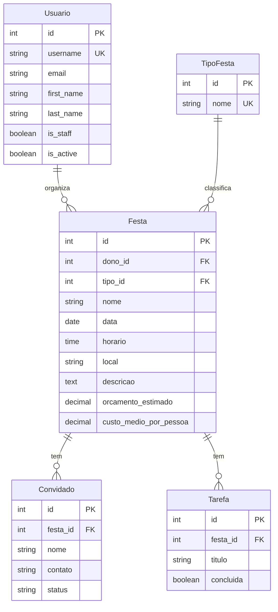

# Diagrama ER

## Como ler

- `||--o{` significa "um para muitos": um usuário organiza muitas festas.
- `PK` é a chave primária, `UK` é um valor único e `FK` é a chave estrangeira.

## Regras de exclusão

- Apagar um **usuário** apaga as festas dele (cascata).
- Um **tipo de festa** que tem festas não pode ser apagado (protegido).
- Apagar uma **festa** apaga os convidados e as tarefas dela (cascata).